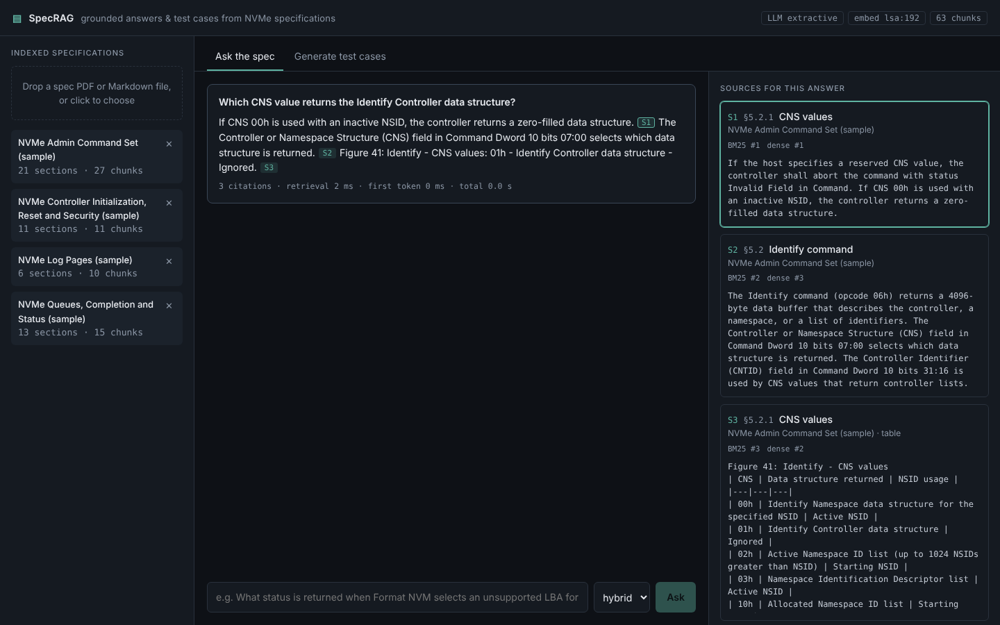
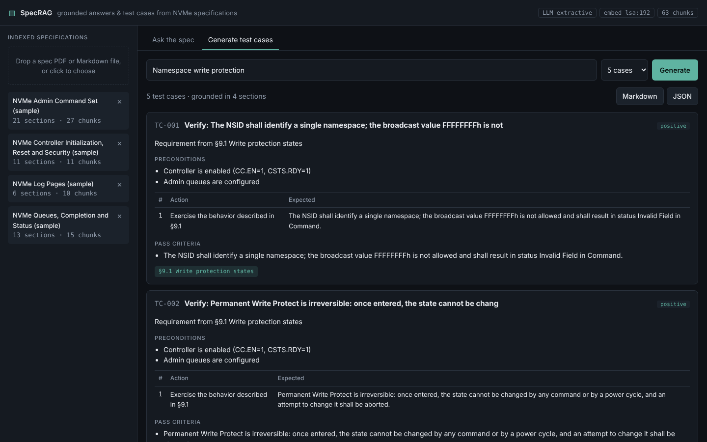
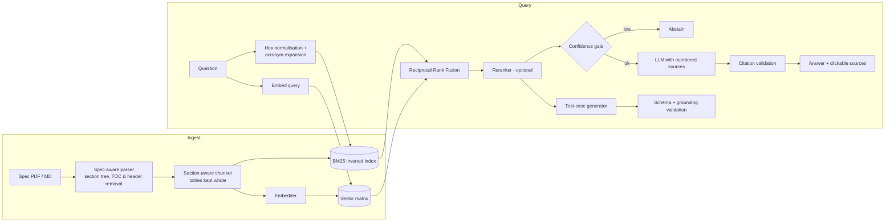

# SpecRAG

**Retrieval-augmented assistant for storage-interface specifications (NVMe / PCIe).** It answers engineering questions with section-level citations and generates structured, spec-traceable validation test cases. It also refuses to answer when the spec doesn't cover the question.

Spec PDFs run to hundreds of pages of numbered sections, bit-field tables and hex opcodes, and generic "chat with a PDF" pipelines handle them poorly. Fixed-size chunking splits a table in half and loses the section number. Embedding search misses exact lookups like "CNS 01h". The model then makes up a status code that sounds plausible. SpecRAG is built around those three failure modes.

```
Q: What happens to writes after a namespace is write protected?

A: Commands that modify user data or metadata are aborted with status Namespace is
   Write Protected [S1]. This covers Write, Write Zeroes, Write Uncorrectable, Dataset
   Management with deallocate, and Format NVM [S1]; reads, Compare, Verify and Flush
   still work [S1].

   [S1] §9.2 Commands affected by write protection   (from the bundled sample corpus)
```




<sub>Screenshots use the bundled sample corpus in offline mode (no LLM). With Ollama, OpenAI or Claude the answers are written in prose.</sub>

## What makes it different

| Problem with naive RAG on specs | What SpecRAG does |
|---|---|
| Fixed-size chunks cut tables in half and lose section context | **Spec-aware parser** rebuilds the numbered section tree from the PDF: from its bookmark outline (exact page and position of every heading, which also works when Word-generated numbering is missing from the text layer), or from heading text as a fallback. It skips table-of-contents lines, strips running headers and footers, and rejects numbered table rows that only look like headings. Chunks never cross a section, tables stay whole (long ones are split by row with the caption and header repeated), and every chunk carries its `§section`, title, breadcrumb and page. |
| Embeddings miss exact identifiers (`06h`, `CNS 01h`, `31:16`) | **Hybrid retrieval**: a from-scratch BM25 with a spec-aware tokenizer (`0x6` = `06h` = `6h`, bit ranges kept intact, a boost for literals) fused with dense vectors through **Reciprocal Rank Fusion**. Acronym expansion (NSID, CNS, LBA, …) is added at a lower weight. An optional cross-encoder or LLM reranker can run on top. |
| Hallucinated fields and status codes | **Grounded generation**: every claim must cite `[S#]`. Citations are validated after generation, so markers pointing at sources that don't exist are removed. **Abstention** happens at two gates: a retrieval-confidence gate before the LLM is called (unknown terms count at maximum IDF), then the model's own `INSUFFICIENT_CONTEXT` reply. |
| Generated test cases you can't trace back to the spec | **Test-case generation** produces schema-validated JSON (positive, negative, boundary, error-handling and state-transition cases). Any case whose `spec_refs` point at sections the model was never shown is **rejected as ungrounded**, and malformed JSON triggers a repair retry. Suites export to Markdown or JSON. |
| "It seems to work" | An **evaluation harness** reports Hit@k, MRR, nDCG, retrieval and chunking ablations, abstention sweeps, citation precision and latency. It runs in CI. |
| Lock-in to one vendor | **Pluggable everything**: Ollama (local, free), OpenAI-compatible endpoints, or Claude for the LLM, and Ollama, sentence-transformers, OpenAI or an offline LSA model for embeddings. Everything is set through environment variables. |

## Architecture



**Stack:** Python 3.12, FastAPI (with token streaming over SSE), NumPy, scikit-learn, pypdf / PyMuPDF, React + TypeScript (Vite), Docker Compose with Ollama, GitHub Actions.

## Quick start

### Option A: Docker (everything local, no API keys)

```bash
docker compose up -d --build        # first run pulls llama3.1:8b + nomic-embed-text
open http://localhost:8080          # drop a spec PDF into the sidebar
```

### Option B: run it directly

```bash
# 1. models (https://ollama.com)
ollama pull llama3.1:8b && ollama pull nomic-embed-text

# 2. backend
cd backend
pip install -r requirements-dev.txt      # optional: pip install -r requirements-optional.txt
cp .env.example .env
python -m scripts.ingest data/sample     # or your spec PDFs, see below
uvicorn app.api:app --reload --port 8000

# 3. frontend
cd ../frontend && npm install && npm run dev   # http://localhost:5173
```

Want to try it with no models installed? Set `LLM_PROVIDER=extractive EMBED_PROVIDER=lsa`. Everything then runs offline: answers are stitched together from the retrieved sentences and table rows, still with citations.

To use Claude or OpenAI instead, set `LLM_PROVIDER=anthropic` with `ANTHROPIC_API_KEY`, or `LLM_PROVIDER=openai` with `OPENAI_API_KEY`.

### Using the real NVMe specifications

`data/sample/` holds a small **illustrative** corpus written for this repo, so the tests and CI run anywhere. Its section numbers don't match the official spec. For real use, download the specs (free) from [nvmexpress.org/specifications](https://nvmexpress.org/specifications/), e.g. the *NVM Express Base Specification* and the *NVM Command Set Specification*, then:

```bash
pip install pymupdf                                 # better reading order for big PDFs
python -m scripts.ingest data/specs/ --rebuild
```

## Evaluation

```bash
# offline, bundled corpus (what CI runs)
python -m eval.run_eval --embed-provider lsa --generate --llm-provider extractive

# your real spec index: bootstrap a QA set, review it by hand, then evaluate
python -m eval.gen_qa --n 60 --out eval/datasets/nvme_base_qa.jsonl
python -m eval.run_eval --index-dir data/index --dataset eval/datasets/nvme_base_qa.jsonl --generate
```

Relevance is judged at the **section level**: a hit means the system retrieved the section an engineer would cite. The dataset mixes `lookup` questions (which use spec terms) with `paraphrase` questions (plain-language, with no field names), plus out-of-scope questions for abstention.

### Results on the NVMe Base Specification 2.1

707-page PDF → 892 sections, 2,755 chunks. 128 questions: 60 `lookup` + 60 `paraphrase` generated from the indexed spec with `eval.gen_qa` and reviewed by hand, plus 8 out-of-scope questions. Embeddings `nomic-embed-text`, LLM `llama3.1:8b`, both local through Ollama.

**Retrieval** (section-level relevance)

| Config | Hit@1 | Hit@5 | MRR@10 | nDCG@10 |
|---|---|---|---|---|
| BM25 (spec tokenizer) | 0.617 | 0.892 | 0.743 | 0.794 |
| Dense (`nomic-embed-text`) | 0.667 | 0.867 | 0.757 | 0.802 |
| **Hybrid RRF** | **0.725** | **0.917** | **0.812** | **0.848** |

| Hit@1 by question type | BM25 | Dense | Hybrid |
|---|---|---|---|
| lookup (spec terms, opcodes) | 0.750 | 0.767 | **0.817** |
| paraphrase (plain language) | 0.483 | 0.567 | **0.633** |

**Answers** (`llama3.1:8b`, 6 retrieved sections per question): 90% of answers cite a correct section, citation precision 0.68, keyword recall 0.75, no in-scope question refused. Latency is p50 9.4 s on a laptop running everything locally.

What the numbers show:
- **Hybrid beats either retriever alone.** It gains +10.8 points of Hit@1 over BM25 and +5.8 over dense retrieval. The biggest gain is on plain-language questions (+15 points over BM25), where exact keywords don't match.
- **Lexical retrieval still matters for specs.** On lookup questions BM25 alone reaches Hit@5 = 1.0.
- **Acronym expansion did not help on this set** (−0.9 Hit@1). It is kept as an option, not claimed as a gain.
- **The abstention gate needs tuning per embedding model.** The default lexical threshold (0.08) refused none of the 8 out-of-scope questions, and the LLM itself refused only 2. A dense similarity threshold of 0.72 separated them almost perfectly (all 8 refused, 4% of in-scope wrongly refused). That threshold was chosen on this same small set, so treat it as indicative and set `ABSTAIN_DENSE_THRESHOLD=0.72` to use it.

Full report: `backend/eval/results/`. The offline sample-corpus run used in CI (LSA embeddings, extractive answers) is in [`sample-corpus-offline.md`](backend/eval/results/sample-corpus-offline.md). On that corpus section-aware chunking more than doubles Hit@1 over fixed-size chunks (0.64 vs 0.22).

## API

| Method | Path | Description |
|---|---|---|
| `POST` | `/api/query` | `{question, mode?, top_k?, doc_ids?}` returns the answer, validated citations, contexts and timings |
| `POST` | `/api/query/stream` | Same request, streamed as Server-Sent Events: `contexts`, then `token`…, then `done` |
| `POST` | `/api/testcases` | `{feature, count}` returns validated test cases with spec references |
| `POST` | `/api/documents` | Multipart upload (PDF / Markdown); parsed, chunked and indexed incrementally |
| `GET` / `DELETE` | `/api/documents[/{id}]` | List or remove indexed specs |
| `GET` | `/api/health` | Active LLM, embedder, reranker and chunk count |

Interactive docs at `http://localhost:8000/docs`.

## Project layout

```
backend/
  app/
    ingest/parser.py       spec-aware PDF/Markdown parsing -> section tree
    ingest/chunker.py      section-aware chunking, table handling
    retrieval/text.py      hex normalisation, tokenizer, acronym expansion
    retrieval/bm25.py      BM25 from scratch (inverted index, literal boost)
    retrieval/embeddings.py  Ollama / OpenAI / sentence-transformers / LSA
    retrieval/reranker.py  cross-encoder and listwise-LLM rerankers
    index.py               hybrid search with RRF, persistence, incremental add/remove
    llm/providers.py       Ollama / OpenAI-compatible / Anthropic / extractive, streaming
    generation/answer.py   cited answers, citation validation, abstention
    generation/testgen.py  structured test cases, grounding validation, JSON repair
    pipeline.py, api.py
  eval/                    metrics, ablation runner, QA bootstrapper, datasets, results
  tests/                   34 tests: parser (incl. generated PDF), retrieval, generation, LLM wire formats, API
frontend/                  React + TS: streaming chat, clickable citations, source inspector, test-case builder
```

## Design notes

- **Why RRF instead of a weighted score sum?** BM25 scores are unbounded and cosine similarities are not, and their distributions shift with each query. Rank fusion needs no score calibration.
- **Why validate citations?** Smaller local models sometimes cite `[S9]` when only six sources were given. Invalid markers are removed, so every citation shown links to text the model actually saw.
- **Why build BM25 from scratch?** It allows a spec-specific tokenizer, the literal boost, and an IDF-based confidence score for abstention. All three are hard to bolt onto an off-the-shelf library.
